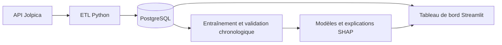

# Prédiction de victoire et de podium en Formule 1

Projet de maîtrise en informatique (intelligence et gestion des données) à l'UQAM. L'application charge les résultats de Formule 1 depuis l'API Jolpica dans une base PostgreSQL, les présente dans un tableau de bord Streamlit et estime, avant les qualifications, la probabilité qu'un pilote gagne une course ou termine sur le podium.

## Contenu

- ETL (`etl/pipeline.py`) : collecte des courses, résultats, qualifications, sprints et classements, validation des types, dédoublonnage et chargement par saison dans un schéma PostgreSQL normalisé (`database/001_schema.sql`).
- Tableau de bord (`app.py`, `dashboard/`) : résultats, championnat, qualifications, calendrier, comparateurs de pilotes et d'écuries, onglet machine learning et explications SHAP.
- Modèles (`ml/train.py`) : régression logistique, forêt aléatoire et gradient boosting de scikit-learn, comparés à une référence naïve, pour deux cibles (victoire et podium).
- Explications (`ml/explain.py`) : contribution de chaque variable à une estimation, calculée avec SHAP.
- Tests : 27 tests unitaires sur des données synthétiques (`tests/`).



## Méthode

Les variables sont calculées uniquement à partir des courses précédentes : moyennes glissantes sur les cinq dernières épreuves du pilote et de son écurie (position, points, victoires, podiums), auxquelles s'ajoutent le pilote, l'écurie et le circuit. La grille de départ n'est pas utilisée, puisque l'estimation se fait avant les qualifications.

La séparation des données suit l'ordre chronologique :

| Étape | Saisons | Lignes |
|---|---|---|
| Entraînement | 2018 à 2022 | 2 060 |
| Validation et choix du modèle | 2023 | 440 |
| Test final, évalué une seule fois | 2024 | 479 |

## Résultats sur la saison 2024

| Cible | Modèle retenu en validation | ROC AUC | Average precision | Log loss | Brier |
|---|---|---|---|---|---|
| Victoire | Gradient boosting | 0,868 | 0,321 | 0,185 | 0,047 |
| Podium | Forêt aléatoire | 0,884 | 0,497 | 0,275 | 0,090 |

Le dossier `resultats/` contient la comparaison des modèles sur 2023 (`validation.csv`), les paramètres de l'exécution (`manifest.json`) et le rapport de test 2024 (`test.json`).

## Lancer le projet

Prérequis : Python 3.12 et un serveur PostgreSQL avec une base `f1_analytics`.

```bash
python -m venv .venv
source .venv/bin/activate          # Windows : .venv\Scripts\Activate.ps1
pip install -r requirements.txt
cp .env.example .env                # remplacer CHANGE_ME par votre mot de passe
psql -d f1_analytics -f database/001_schema.sql
python scripts/check_database.py

# charger chaque saison de 2018 à 2024
python -m etl.pipeline --season 2024

# entraîner, puis évaluer une seule fois sur 2024
python -m ml.train
python -m ml.train --evaluate-test NOM_DE_L_EXECUTION

python -m streamlit run app.py
python -m unittest discover -s tests -v
```

## Limites et suite

- Les estimations sont rétrospectives : elles ne servent pas de prévision pour un prochain Grand Prix.
- La prédiction des abandons, la calibration des probabilités et le déploiement sur Azure restent à faire.

## Documentation

`docs/architecture.md` décrit le schéma de la base et les règles contre la fuite de données. Les fichiers `docs/DEMARRER_S2.md` à `docs/DEMARRER_S6.md` retracent chaque étape du projet.

---

Alimou Diallo · [LinkedIn](https://www.linkedin.com/in/alimou-diallo-883022bb)
