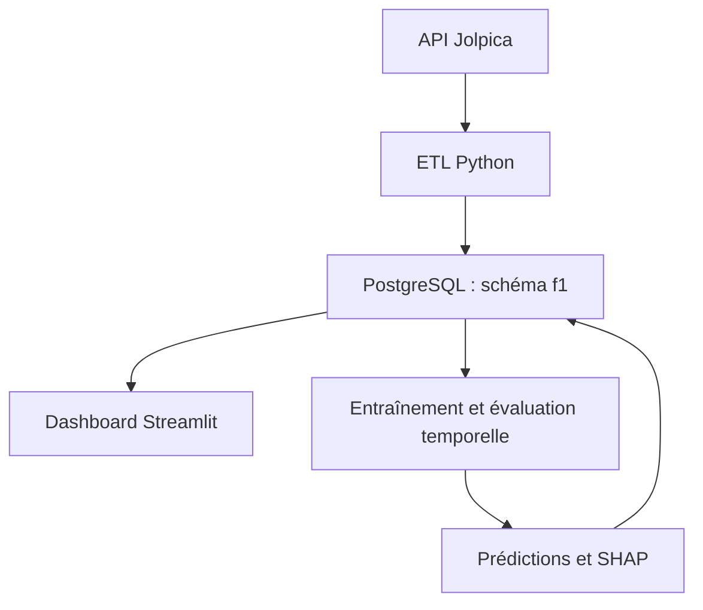

# S1 — Architecture et base de données F1

Périmètre : ETL, dashboard et prédictions. Assistant et recommandation restent des extensions.

## Architecture cible



Les réponses brutes sont archivées dans data/raw. L'ETL valide les types, dédoublonne et charge les tables en transaction. Streamlit lit la base ; il ne déclenche pas l'entraînement à chaque consultation. Les modèles et leurs paramètres sont versionnés séparément des probabilités.

## Dictionnaire et relations

| Table | Grain et clé | Rôle |
|---|---|---|
| circuits | circuit_id | Référentiel des circuits |
| drivers | driver_id | Référentiel des pilotes |
| constructors | constructor_id | Référentiel des écuries |
| races | season, round | Une course, liée à un circuit |
| results | season, round, driver_id | Résultat du Grand Prix, lié à une écurie |
| sprint_results | season, round, driver_id | Résultat du sprint, séparé du Grand Prix |
| qualifying | season, round, driver_id | Qualification, temps en secondes |
| driver_standings | season, round, driver_id | Classement après chaque manche |
| constructor_standings | season, round, constructor_id | Classement après chaque manche |
| model_versions | model_version | Cible, borne d'entraînement et métriques |
| predictions | prediction_id | Probabilité datée, pilote, course, cible et modèle |
| etl_runs | run_id | Suivi des chargements et rejets |

Le SQL fournit les types, clés étrangères et contraintes de chaque champ. Identifiants pilotes/écuries/circuits : identifiants textuels de la source. Les points restent décimaux ; les valeurs inconnues restent NULL. grid=0 représente une grille non attribuée selon la source ; position inconnue reste NULL. Le statut brut est conservé : la définition de DNF sera arrêtée avant l'entraînement.

Ne pas imposer l'unicité d'une position : classements incomplets, sanctions ou données historiques nécessitent une validation métier. Toute probabilité est comprise entre 0 et 1. Les prédictions sont conservées par version et horodatage.

## Démarrage local

Prérequis : Python et un serveur PostgreSQL accessible. Créer une base f1_analytics et un rôle f1_user propriétaire de cette base, avec un mot de passe personnel. Ne pas utiliser un rôle administrateur pour l'application.

```bash
python -m venv .venv
# Linux/macOS
source .venv/bin/activate
# Windows PowerShell : .venv\Scripts\Activate.ps1
pip install -r requirements.txt
```

Copier `.env.example` vers `.env`, puis remplacer CHANGE_ME. Avec psql, se connecter à la base et exécuter :

```sql
\i database/001_schema.sql
```

Puis :

```bash
python scripts/check_database.py
```

Le contrôle vérifie la présence du schéma et un aller-retour dans une table temporaire. Il ne prouve pas toutes les contraintes métier. Le script de création est relançable pour une installation initiale ; IF NOT EXISTS ne constitue pas une migration des tables déjà existantes.

## Raccordement au projet existant en S2

Le stockage existant crée des tables plates dans le schéma public via pandas.to_sql. Le nouveau schéma f1 est volontairement distinct : ne pas pointer ce stockage vers les tables normalisées sans adaptateur.

S2 doit charger circuits/pilotes/écuries, puis courses, résultats, qualifications et classements ; écrire des UPSERT sur les clés composites ; préserver l'atomicité par saison et journaliser les rejets. Adapter ensuite les requêtes du dashboard, en conservant les noms de colonnes attendus. Le mode Parquet existant reste utilisable pendant cette transition.

## Prévenir la fuite de données

Les variables doivent être disponibles avant l'instant de prédiction. Une prédiction avant qualifications ne peut pas utiliser la grille. Les classements de la course cible et son résultat ne sont jamais des variables d'entrée. Les dates feature_cutoff et training_cutoff sont conservées, mais le SQL seul ne vérifie pas leur antériorité à la course : ce contrôle appartient au pipeline ML et à ses tests temporels. Utiliser une séparation chronologique des saisons.

## État de validation

Livrés : architecture, dictionnaire, schéma, exemple de configuration et contrôle de connexion.
Validation statique Python réalisée. Aucun serveur PostgreSQL ni Docker n'est disponible dans l'environnement de préparation : le SQL et la connexion réelle restent à exécuter sur la machine de développement. S1 ne sera validée entièrement qu'après ce contrôle. Aucun déploiement Azure réalisé.
